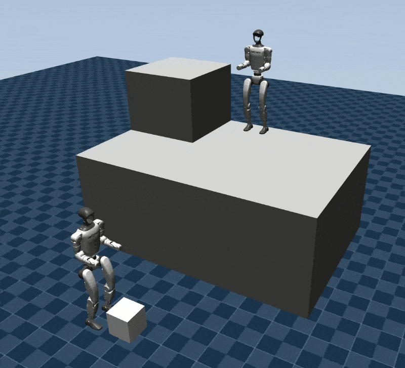
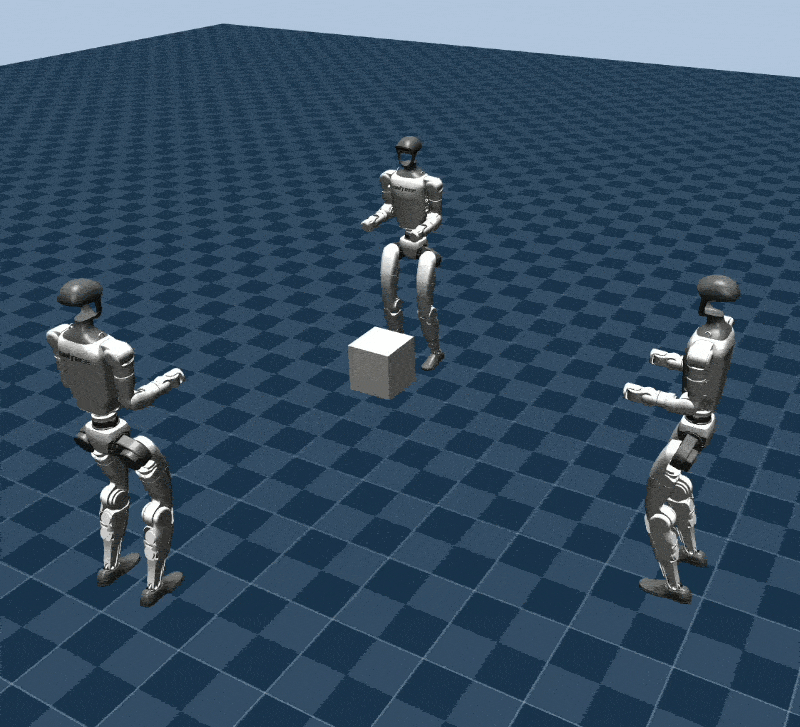
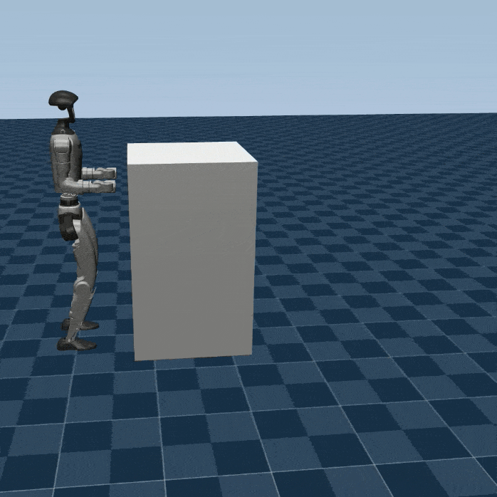
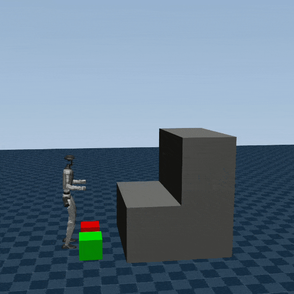
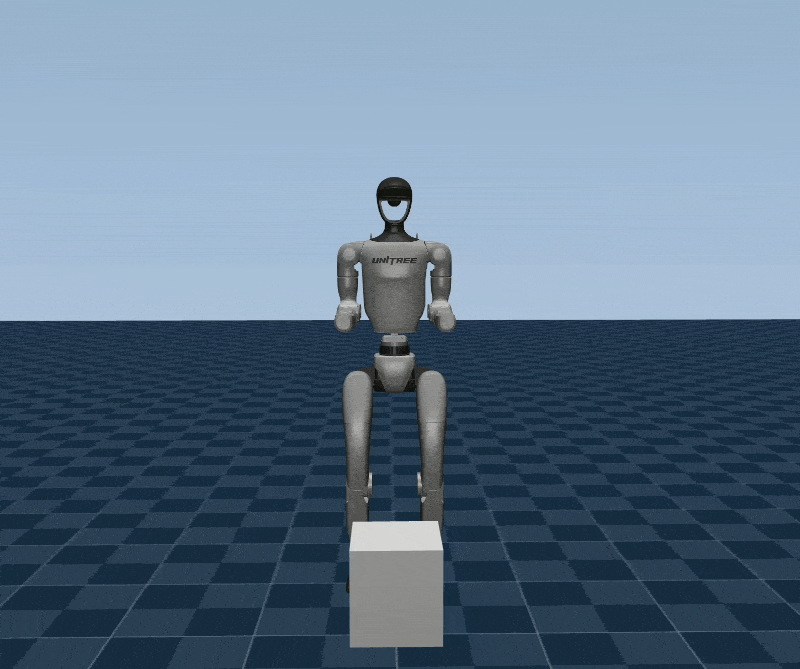
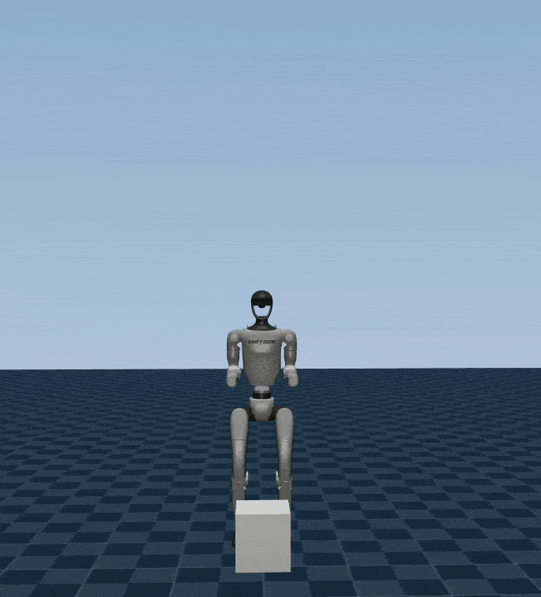
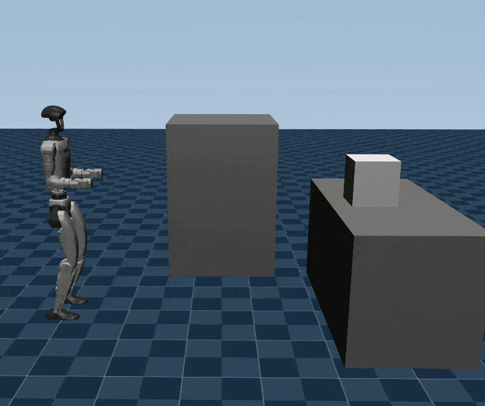
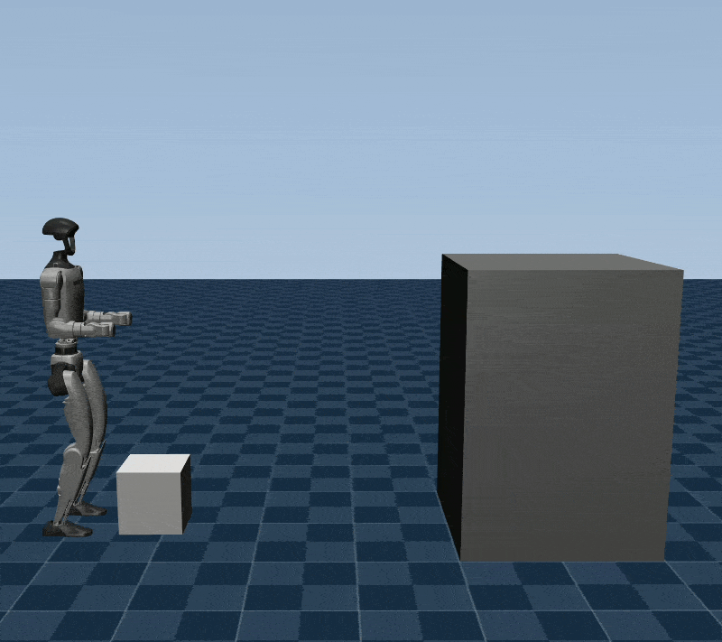

# FARO: Feasibility-Aware Robot Motion Optimization

**Hierarchical contact-explicit optimization for multi-contact robot motion.**

FARO combines contact-sequence search with trajectory optimization to generate
whole-body motions for robots interacting with objects and their environment.
It uses a hierarchy of feasibility checks to reject infeasible contact plans
early and focus dynamic optimization on promising candidates. The framework
supports loco-manipulation, multi-robot coordination, and both sticking and
sliding contacts.

[Paper](https://arxiv.org/abs/2607.18362) ·
[Video](https://youtu.be/R6qCHoCormQ) ·
[Installation](install.md) ·
[Usage](docs/usage.md) ·
[Examples](#examples) ·
[Evaluations](evaluations/README.md) ·
[Citation](#citation) ·
[License](#license)

Research code accompanying **[FARO: Feasibility-Aware Robot Motion Optimization](https://arxiv.org/abs/2607.18362)**<br>
Michal Ciebielski, Shafeef Omar, Aaron Johnson, and Majid Khadiv

The workhorse behind FARO is a **contact-explicit trajectory optimizer** that
jointly optimizes motion, contact forces, and timing for multiple robots and
objects in a single formulation. The examples below show its use in cooperative
manipulation, throwing and catching, pushing with sliding contacts, climbing,
and pick and place.

| Multi-robot handover | Cooperative throwing |
| --- | --- |
|  |  |
| **Pushing with sliding contacts** | **Climbing with movable objects** |
|  |  |
| **Tossing between hands** | **Repeated throwing and catching** |
|  |  |
| **Pick and place between tables** | **Pick and place with one hand** |
|  |  |

## Hierarchical contact-explicit optimization

Given a scene, a contact-sequence generator proposes which robot or object
interfaces should be in contact at each stage. Proposals can come from tree
search, human input, or an external generator such as an LLM. The figure below
shows how FARO evaluates these proposals and turns feasible plans into whole-body
motions.

[](docs/assets/faro_diagram.png)

The central hierarchy checks feasibility at three levels:

1. **Mode/transition optimization:** check individual contact configurations and
   transitions using inverse kinematics, contact constraints, and collision
   avoidance.
2. **Kinematic sequence optimization (KSO):** check the geometric consistency of
   an entire sequence, including contact continuity across transitions.
3. **Trajectory optimization (TO):** optimize robot and object trajectories,
   contact forces, and phase durations subject to dynamics, friction, collision
   constraints, and joint and actuation limits.

The feasibility cache reuses mode and transition checks across candidate plans,
avoiding repeated solves. During search, infeasible proposals feed back into
contact-sequence generation so that alternative plans can be explored. This
early filtering focuses the more expensive optimization stages on promising
sequences; successful trajectory optimization produces motions such as the
climbing example on the right.

The stages share a contact representation and can also be used independently.

## Capabilities

- **Contact-sequence search.** Explore discrete contact choices with
  feasibility-guided tree search, configurable transition rules, and geometric
  and dynamic evaluation. Compare different combinations of feasibility filters.
- **Whole-body trajectory optimization.** Jointly optimize robot motion and
  movable-object dynamics for walking, climbing, picking, placing, throwing,
  and catching.
- **Multi-robot coordination.** Optimize multiple robots and shared objects in
  one scene, with inter-robot collision checking and examples of handovers and
  cooperative throwing.
- **Sticking and sliding contacts.** Model contact creation, release, and
  tangential sliding with friction constraints, including pushing objects while
  maintaining surface contact.
- **Flexible scenes and goals.** Define robot instances, movable objects,
  environment geometry, contact interfaces, and terminal goals through a common
  interface. Included examples use the Unitree G1 humanoid.
- **Evaluation and visualization.** Inspect optimized motions and contact
  forces, evaluate saved LLM-generated contact plans, and run search experiments
  with shared statistics tools.

## Getting started

Follow the [installation guide](install.md) to create `faro_env`, build the solver
dependencies, and install FARO. Then run a pushing example from the repository
root:

```bash
conda activate faro_env
python examples/pushing/box_push.py
```

The script defines a contact sequence, optimizes the motion, and opens a
trajectory visualization. Read the [usage and architecture guide](docs/usage.md)
for an overview of the code, modeling assumptions, and contracts
to preserve when making changes.

## Examples

| Task | Entry point |
| --- | --- |
| Pushing with sliding contacts | [Box pushing](examples/pushing/box_push.py) |
| Pick and place | [Two tables](evaluations/human_input/pick_place_2/two_table_pick_place.py) · [One hand](evaluations/human_input/pick_place_1/pick_place_one_hand.py) |
| Multi-robot handover | [Passing a box to a raised platform](examples/multi_robot/two_g1_pass_up.py) |
| Cooperative throwing | [Two robots](examples/multi_robot/two_g1_throw.py) · [Three robots](examples/multi_robot/three_g1_throw.py) |
| Climbing with movable objects | [Two-box ascent](evaluations/human_input/climb_2/ctrl_ascent.py) |
| Dynamic object manipulation | [Tossing between hands](evaluations/human_input/juggle/toss_between_hands.py) · [Repeated throwing and catching](evaluations/human_input/triple_catch/triple_throw_catch_regular.py) |
| Individual optimization stages | [IK](scripts/main_ik.py) · [KSO](scripts/main_kso.py) · [TO](scripts/main_to.py) |

For contact-planning experiments, see the [evaluation guide](evaluations/README.md),
covering tree-search variants, saved LLM contact plans, and the AHMP CEM baseline.
Scene definitions and task goals are in [`src/scenes`](src/scenes).

## Citation

If you use FARO in your research, please cite:

```bibtex
@article{ciebielski2026faro,
  title={FARO: Feasibility-Aware Robot Motion Optimization},
  author={Ciebielski, Michal and Omar, Shafeef and Johnson, Aaron and Khadiv, Majid},
  journal={arXiv preprint arXiv:2607.18362},
  year={2026}
}
```

## License

FARO is licensed under the [BSD 3-Clause License](LICENSE).
Third-party code and assets retain their respective licenses.
